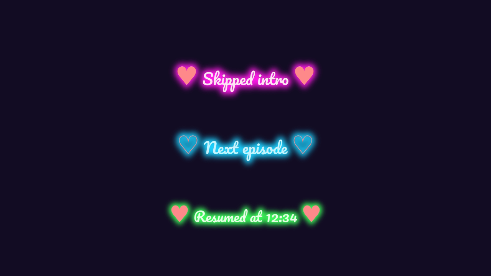
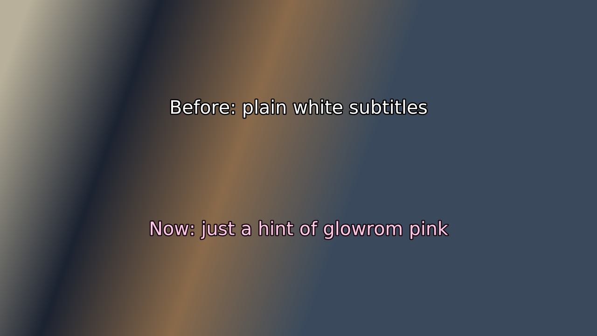

# glowrom ♥

**A media center for your own videos.** Browse your library, play it on your TV, and let glowrom do the fiddly parts:
it skips intros and credits for you, picks up where you left off, looks up descriptions, and keeps your files tidy.
Control it from a terminal or from your phone.

> The pictures here are previews drawn with the same styling the player uses.

## Download

| | |
|---|---|
| **Linux** (x86-64) | [glowrom-linux-amd64.tar.gz](https://github.com/girlypopicon/glowrom/releases/latest/download/glowrom-linux-amd64.tar.gz) |
| **Linux** (arm64) | [glowrom-linux-arm64.tar.gz](https://github.com/girlypopicon/glowrom/releases/latest/download/glowrom-linux-arm64.tar.gz) |
| **Windows** | coming soon |
| Checksums | [SHA256SUMS](https://github.com/girlypopicon/glowrom/releases/latest/download/SHA256SUMS) |

All releases: **[github.com/girlypopicon/glowrom/releases](https://github.com/girlypopicon/glowrom/releases)**.
Install guide for Linux: [INSTALL-linux.md](INSTALL-linux.md). This is a **beta**, and the Linux build is for people who are
comfortable with a terminal.

## What it does

- **Plays on your TV** with [mpv](https://mpv.io), and remembers where you stopped. Resume, watched markers, "continue watching".
- **Skips intros and credits by itself.** It listens for the music the episodes share (or reads the file's chapters), so it works
  even when a show changes its opening part-way through.
- **Descriptions and episode names** from [TMDB](https://www.themoviedb.org) (you bring your own free key).
- **Keeps your library tidy:** one naming convention, rename with a preview and an undo, duplicate detection, and a review list
  for anything it isn't sure about.
- **TV Mode:** an endless channel of random episodes and films, whole and unskipped, like real TV. **Shuffle** a folder with one key.
- **On-screen messages worth looking at:** neon cursive pop-ups with hearts, a title card when something starts, a "Paused" that
  stays put, and an idle screen with drifting lights and little tips instead of a black TV.
- **Glowrom Pink subtitles:** a slight pink tint, just enough to say you're using glowrom (and easy to switch off).
- **A phone remote** (a web page you open on your phone) to control playback and browse your library.
- **Checks your files** for damage by playing them through, and tells you plainly what it found.

  
  

## You will need

- **mpv** 0.37 or newer and **ffmpeg** (with `ffprobe`)
- your videos in a folder (`movies/` and `tv/` inside it)
- a free TMDB API key for descriptions (optional)

## Something went wrong?

Run `glowrom report`. It writes a text file with your versions, settings (never your keys) and the last lines of the log, with
anything secret removed. Read it, then [open an issue](https://github.com/girlypopicon/glowrom/issues) and attach it.

## Terms

Free to use. The source code is not published. See [LICENSE](LICENSE). Open-source components and the Pacifico font are
credited in `THIRD-PARTY-NOTICES.txt` inside every download. Colours and type: [BRAND.md](BRAND.md).
